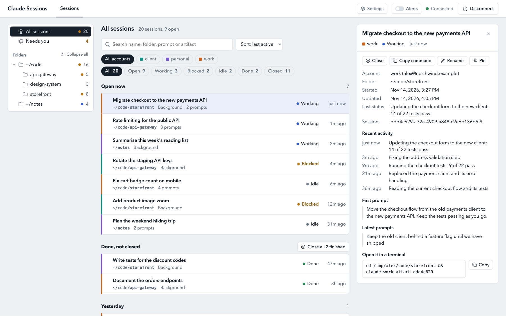

# cc-sessions

One place to see, close and resume [Claude Code](https://claude.com/claude-code) and
[Codex](https://github.com/openai/codex) sessions across every account on a machine, from
a local web page or the command line. It also adds, renames, re-logs-in, removes and
restores the accounts themselves.

An account is a config folder of one of the two tools (`~/.claude`, `~/.claude-work`,
`~/.codex`, `~/.codex-work`, ...) with a name and a shortcut command. Each tool only sees
one account at a time; cc-sessions reads every account and shows the result together,
grouped by project folder, with the Usage view counting both.

It is a single small program with nothing else to install, for macOS, Linux and Windows.
It is an unofficial tool and is not affiliated with Anthropic.

## See it

[](docs/demo.mp4)

The screenshot shows the classic layout. The one-minute film
([docs/demo.mp4](docs/demo.mp4)) introduces 2.5: the Finder layout, Usage, Settings and
accounts. Both use made-up demo data.

## Install

macOS and Linux:

```sh
curl -fsSL https://raw.githubusercontent.com/barath-dev/cc-sessions/main/install.sh | sh
```

Windows (PowerShell):

```powershell
irm https://raw.githubusercontent.com/barath-dev/cc-sessions/main/install.ps1 | iex
```

The installer downloads the program for your system, checks it against the release's
SHA-256 list, and asks a few setup questions. Each has a default, so pressing Enter through
them works:

1. **Command name** — what you type to start it (default `cc-sessions`).
2. **Port** for the page (default `4777`).
3. **Clickable shortcut** in Applications or the Start menu (default yes).
4. **Register the Claude Code folders it finds** as accounts (default yes).
5. **Manage the `claude-<name>` shortcuts** that start each account (default yes). It shows
   the one line it would add to your shell's startup file, and keeps a backup.
6. **Keep it up to date automatically** (default yes). See [Updates](#updates).

Run `cc-sessions setup` to change any answer later.

## Updates

From 2.6.0 on, cc-sessions keeps itself up to date. Once a day the server asks GitHub for
the latest release. When there is a newer one it downloads the program for your system,
checks it against the release's SHA-256 list, puts it in place and restarts on it.
Settings and sessions are not touched, and a close in progress finishes first.

After an update the page reloads and opens a **What's new** window (from 2.7.2): the
changes in every version since the one you had, newest first, with a link to all the
release notes. It shows once per update; **Got it** or Esc closes it.

- Turn it off in **Settings › General › Updates**, or answer no in `cc-sessions setup`.
  With it off, the same place has **Update now**, and `cc-sessions update` installs the
  latest version from a terminal (`--check` only looks).
- **What's new** in the same place shows the last few versions' changes at any time.
- Only the copy the installer put in place updates itself. A build from source is told
  about new versions and left alone.
- It uses the system's `curl` (or `wget`, or PowerShell on Windows) and sends nothing but
  the request for the latest release.
- Versions before 2.6.0 cannot update themselves: run the install line once more.

## Reporting problems

**Settings › General › Report a problem** (or the **Report** button on any error message,
or `cc-sessions report`) opens a new GitHub issue filled in with the version, system,
Claude Code version, number of accounts and the last few error messages. It shows you all
of it first, and leaves out folder paths, session names, prompts and emails. You describe
what happened on GitHub before anything is sent. **Suggest a feature** is next to it.

## Start and stop

```
cc-sessions          # start the server if needed and open the page
cc-sessions stop     # stop the server (same as Disconnect in the page)
```

The server runs in the background on `http://127.0.0.1:4777`, so the terminal can be
closed. Nothing starts at login. It stops by itself after 30 minutes with no page open,
and **Disconnect** (in the classic header, or Settings › General) stops it straight away.
Your Claude sessions keep running either way.

## The page

The page has two layouts, picked in **Settings › Appearance › Layout**; it opens in the one
you used last. Both show the same sessions and accounts; alerts are in the classic layout
and token usage in the Finder layout.

### Classic layout

- **One list** of every session in every account: pinned ones first, then the ones open
  now, then saved conversations by when they were last active (or A–Z).
- **A folder tree** beside it. Pick a folder to see only what is under it; pin one to keep
  it at the top. **Needs you** lists sessions that are blocked, or finished in the last day
  and not yet closed, and the browser tab shows how many.
- **Search** covers names, folders, artifacts and what you typed in each conversation.
  Account and status chips narrow the list.
- **Details** open in a panel beside the list when you click a session: its prompts,
  artifacts (links to claude.ai, which open for the Claude login that published them) and
  the command that resumes it.
- **Actions**, on each row as you point at it: rename, copy the resume command, pin, open
  its folder in your code editor, and **Close** (stops the session, keeps its conversation)
  or **Resume** (reopens it in a new terminal window). Tick open sessions to close several
  at once.
- Conversations that were opened and never used are hidden, with a link to show them.
- **Alerts**, in the header, show a desktop notification when a session starts waiting for
  you or finishes. They need the page open in a browser tab.

### Finder layout

A Finder-style browser of the same sessions: folders you open like folders, sessions as
files in them, accounts as tags in the sidebar.

- **Icons, List and Columns** views, back and forward, a path bar, and Recents, Needs you
  and Open now in the sidebar. Click a column heading in the List view to sort by it
  (name, status, account, last active, prompts, tokens or tokens per prompt); click it
  again to reverse. **Per prompt** finds sessions that used a lot for each thing asked,
  often ones going round in circles on the same problem.
- **Worth a look** (in the sidebar, and as a badge on the session) lists sessions that may
  have gone round in circles: the same error coming back after each fix, edits undoing
  earlier edits, many tokens for little changed, or you saying it still isn't working. Only
  sessions with real work in them are judged (20+ replies, 250K+ tokens without cache
  reads, 5+ edits to the project), against your own usual. Quick Look says why; **Not a
  loop** hides it and makes the check a little stricter from then on.
- **Quick Look** (Space or double-click) shows a session's details and actions; a
  right-click menu has the rest, including **Open in VS Code** (or Cursor, Zed...) for a
  session's folder or a whole folder of sessions.
- Keys as in Finder: arrows to move, Enter to rename, ⌘↑ for the folder above, ⌘[ and ⌘]
  for back and forward, ⌘1–3 for the views, ⌘O to resume, ⌘⌫ to close (after asking),
  ⌘E to open in your code editor, ⌘, for Settings.
- **Usage** shows the tokens your sessions used: today, the last 7 and 30 days, a calendar
  heat map of every day, when in the week you use Claude, and totals by account, model
  and session. Pick all tokens, without cache reads, or output only. The heat maps come in
  blue, green, amber, purple, teal or your primary colour. **3D** raises the calendar into
  a lit 3D object, a block per day as tall as its tokens, with height lines and the busiest
  day and today marked. Pick a view (Angled, Front, Top, Side, Last 30 days, or keys 1–5),
  drag to turn it, Shift-drag to move it, ⌘-scroll to zoom, or show it full screen. Click a
  day (or move to it with the arrow keys and press Enter) to see its tokens by kind, hour
  and account, how it compares with its week and the year, and the sessions that used them.

### Both layouts

- **Rename** a session with the pencil on its row, by double-clicking its name, or with
  Enter in the Finder layout. The name is kept by cc-sessions and shown in the page and on
  the command line; Claude Code and Codex keep their own titles. Clear the name to go back to that title.
- **Settings**, from the classic header or the Finder sidebar:
  - **Appearance**: the layout; Light, Dark or Match system; a template (Mac, Classic,
    Graphite or Paper, or each layout's own look); and a primary colour for buttons, links
    and what is selected. These are kept in the browser.
  - **Accounts**: tool, login, plan, shortcut and folder of each account. Add (as a Claude
    Code or a Codex account), rename, change login, remove and restore. **Edit…** opens one dialog for an account's name, alias,
    colour (which marks it everywhere), login and removal.
  - **General**: **updates** (version, check now, automatic or not), **report a problem**
    and **suggest a feature**, the **code editor** that folders open in, picked from the ones found on
    this computer (VS Code, Cursor, Windsurf, Zed, VSCodium, Sublime Text, IntelliJ IDEA,
    WebStorm, PyCharm, GoLand, RustRover, Android Studio), and disconnecting, which stops
    the server.
- **From the keyboard** in the classic layout, **Skip to sessions** is the first stop, the
  arrow keys move through the list and the folder tree, and Esc closes the details.

Statuses: `Working` (busy on a task), `Blocked` (waiting for your input), `Idle` (open in
a terminal, doing nothing), `Done` (background task finished, not closed), `Closed`
(stopped through this tool, or stopped in Claude Code or Codex).

A Codex account's name is shown with a small **Codex** mark where the name does not
already say so.

## What it never does

- It never deletes or moves anything under an account folder. The test suite checks this
  on every run.
- **Remove account** only hides the account and drops its shortcut. The folder, login and
  history stay on disk, and **Restore** brings it back.
- **Close** only stops a session. Its transcript stays and it can be resumed.
- Renaming an account or its shortcut changes nothing inside the account folder.
- Renaming or pinning a session changes nothing in its transcript. Names and pins are kept
  in `titles.json` and `pins.json`.
- Its own records are rewritten in place with the previous version kept as `<file>.bak`.

The only files it removes are its own launchers: its pid file, a command link it created
when you change the command name, and on Windows the `claude-<name>.cmd` or
`codex-<name>.cmd` launcher of an account you renamed or removed. None of them hold data.

Claude Code itself deletes conversations after `cleanupPeriodDays` (30 by default) without
activity. Settings › Accounts shows that number per account. To keep history longer, set
`cleanupPeriodDays` in that account's `settings.json`. Codex keeps its conversations until
they are deleted.

## Command line

```
cc-sessions list [--folder PATH] [--account NAME] [--open | --closed | --all] [--json]
cc-sessions history [--folder PATH] [--account NAME] [--by-date] [--json]
cc-sessions close <id>... | --folder PATH | --account NAME  [--yes]
cc-sessions rename <id> NEW NAME | --reset
cc-sessions account list [--removed]
cc-sessions account add NAME [--tool claude|codex] [--alias A] [--dir PATH] [--no-login]
cc-sessions account rename NAME NEW-NAME [--alias A]
cc-sessions account login NAME
cc-sessions account remove NAME [--yes]
cc-sessions account restore NAME [--alias A]
cc-sessions setup [--yes] [--command NAME] [--port N] [--shortcut | --no-shortcut] [--no-import] [--no-aliases] [--no-auto-update]
cc-sessions update [--check]
cc-sessions report
```

Session ids are shown as `account:id`. `close` asks before closing, asks separately for
each interactive session, and skips the session it is run from. `--yes` only skips the
question for background sessions. `history` groups by folder; `--by-date` prints one list,
newest first. `rename` takes the id `history` shows, and `--reset` gives a session its own
title back. `account add` makes a Claude Code account unless `--tool codex` says otherwise;
a Codex account's folder defaults to `~/.codex-NAME` and its shortcut to `codex-NAME`.

A Codex session's short id is the end of its id, not the start: Codex ids begin with the
time they were made, so conversations started together share their first characters.

## Differences between systems

| | macOS / Linux | Windows |
|---|---|---|
| Settings and records | `~/.config/cc-sessions` | `%APPDATA%\cc-sessions` |
| Program | `~/.local/share/cc-sessions/cc-sessions` | `%LOCALAPPDATA%\cc-sessions\cc-sessions.exe` |
| Account shortcuts | aliases loaded by one line in `~/.zshrc` or `~/.bashrc` (fish: a `conf.d` file) | `claude-<name>.cmd` and `codex-<name>.cmd` launchers on your PATH |
| Closing an interactive session | asks it to exit, and leaves it if it has not within 5 seconds | ends it immediately; Windows offers no gentler way |
| Running Codex sessions | found from the running processes (`ps`, and `lsof` on macOS) | not found yet; saved Codex conversations are listed and can be resumed |
| Resume opens | iTerm or Terminal; on Linux the first terminal program found | Windows Terminal, else Command Prompt |

On macOS, Resume and Log in type their command into the new iTerm or Terminal window, as
`env CLAUDE_CONFIG_DIR=<folder> claude …` (or `CODEX_HOME` and `codex`), after clearing
the line. A key pressed while the window comes to the front cannot change which account
the command runs as; at worst the command is not found.

On a Linux machine with no desktop (for example over SSH), Resume cannot open a terminal
window; the Copy button still gives the command. Claude Code running inside WSL is covered
by installing the Linux version inside WSL.

The Windows program is not code-signed, so antivirus software may occasionally flag it.

## Files it keeps

In the settings folder above:

| File | Purpose |
|---|---|
| `config.json` | Answers from setup: command name, port, shortcut, idle limit, automatic updates. |
| `accounts.json` | Account registry: name, tool, folder, shortcut, colour, removed flag. |
| `aliases.sh` | Generated account shortcuts (macOS, Linux). |
| `icon.png`, `icon.ico` | Icon of the clickable shortcut (Linux, Windows). |
| `closed.json` | Sessions closed through the tool. |
| `titles.json` | Names you gave to sessions. |
| `pins.json` | Sessions and folders you pinned. |
| `history-cache.json` | Rebuildable index of saved conversations, with their token counts. |
| `ui-token` | Access key for the web app (readable only by you). |
| `ui.pid`, `ui.log` | The running server's pid and its log. |
| `update.json` | The last update check, and the last update installed (for What's new). |

`idleMinutes` in `config.json` sets how long the server waits with no page open before it
stops; `0` keeps it running until you stop it.

The layout, theme, template and primary colour are kept in the browser, not here, so
another browser starts with the defaults.

## How the server is protected

The page can end processes, so the server listens on `127.0.0.1` only, requires the token
from `ui-token` on every API call, rejects requests whose `Host` is not
`127.0.0.1:<port>` or `localhost:<port>`, and only accepts JSON `POST`s for changes.

## How sessions are read and closed

### Claude Code

- Sessions come from `claude agents --json --all`, run once per account. The default
  account runs with `CLAUDE_CONFIG_DIR` unset; the others with it set to their folder.
- Background sessions are closed with `claude stop <id>`. For an interactive one, the tool
  first checks that the process id still belongs to that session, then ends it.
- Claude Code has no "closed" state for interactive sessions (they vanish once their
  process ends) and leaves a finished background session as `done` after `claude stop`.
  `closed.json` is what keeps both listed as closed.
- History is read from `<account>/projects/<folder>/<session>.jsonl`, top level only,
  read-only. Artifacts are the links Claude Code records there when a conversation
  publishes or opens one.
- Token counts come from the usage Claude Code records on each reply in those files. A
  reply written over several lines is counted once. Sub-agents keep conversations of their
  own, which are not counted, and days older than an account's `cleanupPeriodDays` are
  empty because Claude Code has deleted them.

### Codex

- Codex has no command that lists its running sessions. cc-sessions looks for running
  `codex` programs, leaving out its background service (`codex app-server`), its helpers
  (`codex-code-mode-host`, `codex-exec-server`) and commands like `codex login`. Since
  Codex 0.160 a session's turns run in that background service, which writes the
  conversation file, so a session is matched by the conversation `codex resume` was given,
  or by its folder (`-C`, else its own) and the newest conversation there since it
  started. Several windows in one folder are matched newest first, each to a conversation
  of its own. One run with `--no-daemon` writes the file itself and is matched by it.
- Two limits follow from that. Two windows in one folder that get their first prompts in
  the opposite order to the one they were opened in may be shown the wrong way round:
  nothing tells them apart. And a window started with a prompt whose first word is a
  Codex command (`codex "update the docs"`) looks like that command (`codex update`), and
  is not listed.
- The end of the conversation file says whether a session is working or idle. Codex does
  not write approval requests there, so for a session the file says is working, the
  background service is asked (`thread/read`) whether it is waiting for an approval or an
  answer.
- The background service carries on with a turn after its window is closed. Such a turn is
  listed as working, without a window, once the service confirms it is still running. So
  is a conversation whose last turn left a command running ("Process running with session
  ID" in its output): Codex keeps those in background terminals after the turn ends.
- Closing checks the process is still that Codex session, stops the turn it is in the
  middle of through the background service (`turn/interrupt`, by way of
  `codex app-server proxy`) and ends the commands it left running
  (`thread/backgroundTerminals/clean`, as Codex's `/stop` does), then asks the window to
  exit, as for Claude Code. A window run
  with `--no-daemon` runs each command in a process group of its own, which would outlive
  it, so those are ended with it.
- History is read from `<account>/sessions/YYYY/MM/DD/rollout-*.jsonl`, and from the
  `.jsonl.zst` files Codex compresses finished ones into, read-only. Conversations archived
  in Codex are left out, as are sub-agents' threads and side conversations left empty.
  Titles are the names Codex keeps in `session_index.jsonl`, else the first prompt; a
  `codex review` has none, and is named after what it reviews.
- The loop check reads Codex's patches and the commands that failed, also when Codex runs
  them from a script of its own (code mode), where each command's own output is taken
  without the script's timings.
- Token counts come from the running totals Codex records after each reply. A forked
  conversation's first total includes its parent's, so only its own reply counts there.
- Who is signed in is read from the email and plan in the identity token in the account's
  `auth.json` (nothing else in it is read), or from `codex login status` when Codex keeps
  the login in the system keychain. The default account runs with `CODEX_HOME` unset; the
  others with it set to their folder. Resume runs `codex resume <id>` in the session's
  folder.

## Building from source

```sh
cargo build --release      # target/release/cc-sessions
cargo test                 # unit tests, and end-to-end tests against a fake claude (and codex)
```

Everything that differs between systems is in `src/os/`. The page is in `ui/` and is built
into the program; set `CC_SESSIONS_UI_DIR=ui` to serve it from disk while working on it.
`CC_SESSIONS_HOME` and `CC_SESSIONS_PORT` point a run at a different settings folder and
port.

Each release adds its notes to the top of `ui/changes.json` (version, date, title, notes),
which the What's new window reads. `cargo test` fails if the first entry is not the
version in `Cargo.toml`, so bump both together.

## Licence

MIT. See [LICENSE](LICENSE). The icons are from [Lucide](https://lucide.dev) (ISC licence;
the notice is in `ui/icons.js`).
