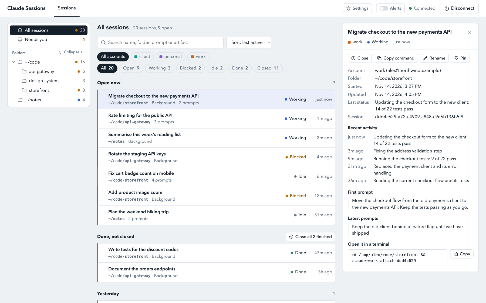

# cc-sessions

One place to see, close and resume [Claude Code](https://claude.com/claude-code) sessions
across every account on a machine, from a local web page or the command line. It also
adds, renames, re-logs-in, removes and restores the accounts themselves.

An account is a Claude Code config folder (`~/.claude`, `~/.claude-work`, ...) with a name
and a shortcut command. `claude agents` only sees one account at a time; cc-sessions asks
each account in turn and shows the result together, grouped by project folder.

It is a single small program with nothing else to install, for macOS, Linux and Windows.
It is an unofficial tool and is not affiliated with Anthropic.

## See it

[](docs/demo.mp4)

A one-minute narrated tour of the page: [docs/demo.mp4](docs/demo.mp4). It uses made-up demo data.

## Install

macOS and Linux:

```sh
curl -fsSL https://raw.githubusercontent.com/barath-dev/cc-sessions/main/install.sh | sh
```

Windows (PowerShell):

```powershell
irm https://raw.githubusercontent.com/barath-dev/cc-sessions/main/install.ps1 | iex
```

The installer downloads the program for your system, checks it against the release's
SHA-256 list, and asks a few setup questions. Each has a default, so pressing Enter through
them works:

1. **Command name** — what you type to start it (default `cc-sessions`).
2. **Port** for the page (default `4777`).
3. **Clickable shortcut** in Applications or the Start menu (default yes).
4. **Register the Claude Code folders it finds** as accounts (default yes).
5. **Manage the `claude-<name>` shortcuts** that start each account (default yes). It shows
   the one line it would add to your shell's startup file, and keeps a backup.

Run the install line again to update; settings are kept. Run `cc-sessions setup` to change
any answer later.

## Start and stop

```
cc-sessions          # start the server if needed and open the page
cc-sessions stop     # stop the server (same as Disconnect in the page)
```

The server runs in the background on `http://127.0.0.1:4777`, so the terminal can be
closed. Nothing starts at login. It stops by itself after 30 minutes with no page open,
and **Disconnect** in the page header stops it straight away. Your Claude sessions keep
running either way.

## The page

- **Sessions** — live interactive sessions and all background sessions, grouped by folder,
  refreshed every 5 seconds. Filter by account, status or text. Click a row for details.
  **Close** stops a session and keeps its conversation; **Resume** reopens a closed one in
  a new terminal window.
- **History** — every saved conversation in every account, newest activity first, grouped
  **By date** or **By folder**, with a preview of its prompts and a **Resume** button. A
  conversation that published artifacts lists them with links to claude.ai; they open for
  the Claude login that published them.
- **Rename**, on any session or conversation, gives it a name of your own. The name is
  kept by cc-sessions and shown in both tabs and on the command line; Claude Code keeps
  its own title. Clear the name to go back to that title.
- **Accounts** — login, plan, shortcut and folder of each account. Add, rename, change
  login, remove and restore.

The picker in the header switches between **Light**, **Dark** and **Match system**.

Statuses: `Working` (Claude is busy), `Blocked` (waiting for your input), `Idle` (open in
a terminal, doing nothing), `Done` (background task finished, not closed), `Closed`
(stopped through this tool, or stopped in Claude Code).

## What it never does

- It never deletes or moves anything under an account folder. The test suite checks this
  on every run.
- **Remove account** only hides the account and drops its shortcut. The folder, login and
  history stay on disk, and **Restore** brings it back.
- **Close** only stops a session. Its transcript stays and it can be resumed.
- Renaming an account or its shortcut changes nothing inside the account folder.
- Renaming a session changes nothing in its transcript. The name is kept in `titles.json`.
- Its own records are rewritten in place with the previous version kept as `<file>.bak`.

The only files it removes are its own launchers: its pid file, a command link it created
when you change the command name, and on Windows the `claude-<name>.cmd` launcher of an
account you renamed or removed. None of them hold data.

Claude Code itself deletes conversations after `cleanupPeriodDays` (30 by default) without
activity. The Accounts tab shows that number per account. To keep history longer, set
`cleanupPeriodDays` in that account's `settings.json`.

## Command line

```
cc-sessions list [--folder PATH] [--account NAME] [--open | --closed | --all] [--json]
cc-sessions history [--folder PATH] [--account NAME] [--by-date] [--json]
cc-sessions close <id>... | --folder PATH | --account NAME  [--yes]
cc-sessions rename <id> NEW NAME | --reset
cc-sessions account list [--removed]
cc-sessions account add NAME [--alias A] [--dir PATH] [--no-login]
cc-sessions account rename NAME NEW-NAME [--alias A]
cc-sessions account login NAME
cc-sessions account remove NAME [--yes]
cc-sessions account restore NAME [--alias A]
cc-sessions setup [--yes] [--command NAME] [--port N] [--shortcut | --no-shortcut] [--no-import] [--no-aliases]
```

Session ids are shown as `account:id`. `close` asks before closing, asks separately for
each interactive session, and skips the session it is run from. `--yes` only skips the
question for background sessions. `history` groups by folder; `--by-date` prints one list,
newest first. `rename` takes the id `history` shows, and `--reset` gives a session its own
title back.

## Differences between systems

| | macOS / Linux | Windows |
|---|---|---|
| Settings and records | `~/.config/cc-sessions` | `%APPDATA%\cc-sessions` |
| Program | `~/.local/share/cc-sessions/cc-sessions` | `%LOCALAPPDATA%\cc-sessions\cc-sessions.exe` |
| Account shortcuts | aliases loaded by one line in `~/.zshrc` or `~/.bashrc` (fish: a `conf.d` file) | `claude-<name>.cmd` launchers on your PATH |
| Closing an interactive session | asks it to exit, and leaves it if it has not within 5 seconds | ends it immediately; Windows offers no gentler way |
| Resume opens | iTerm or Terminal; on Linux the first terminal program found | Windows Terminal, else Command Prompt |

On a Linux machine with no desktop (for example over SSH), Resume cannot open a terminal
window; the Copy button still gives the command. Claude Code running inside WSL is covered
by installing the Linux version inside WSL.

The Windows program is not code-signed, so antivirus software may occasionally flag it.

## Files it keeps

In the settings folder above:

| File | Purpose |
|---|---|
| `config.json` | Answers from setup: command name, port, shortcut, idle limit. |
| `accounts.json` | Account registry: name, folder, shortcut, removed flag. |
| `aliases.sh` | Generated account shortcuts (macOS, Linux). |
| `icon.png`, `icon.ico` | Icon of the clickable shortcut (Linux, Windows). |
| `closed.json` | Sessions closed through the tool. |
| `titles.json` | Names you gave to sessions. |
| `history-cache.json` | Rebuildable index of saved conversations. |
| `ui-token` | Access key for the web app (readable only by you). |
| `ui.pid`, `ui.log` | The running server's pid and its log. |

`idleMinutes` in `config.json` sets how long the server waits with no page open before it
stops; `0` keeps it running until you stop it.

## How the server is protected

The page can end processes, so the server listens on `127.0.0.1` only, requires the token
from `ui-token` on every API call, rejects requests whose `Host` is not
`127.0.0.1:<port>` or `localhost:<port>`, and only accepts JSON `POST`s for changes.

## How sessions are read and closed

- Sessions come from `claude agents --json --all`, run once per account. The default
  account runs with `CLAUDE_CONFIG_DIR` unset; the others with it set to their folder.
- Background sessions are closed with `claude stop <id>`. For an interactive one, the tool
  first checks that the process id still belongs to that session, then ends it.
- Claude Code has no "closed" state for interactive sessions (they vanish once their
  process ends) and leaves a finished background session as `done` after `claude stop`.
  `closed.json` is what keeps both listed as closed.
- History is read from `<account>/projects/<folder>/<session>.jsonl`, top level only,
  read-only. Artifacts are the links Claude Code records there when a conversation
  publishes or opens one.

## Building from source

```sh
cargo build --release      # target/release/cc-sessions
cargo test                 # unit tests, and end-to-end tests against a fake claude
```

Everything that differs between systems is in `src/os/`. The page is in `ui/` and is built
into the program; set `CC_SESSIONS_UI_DIR=ui` to serve it from disk while working on it.
`CC_SESSIONS_HOME` and `CC_SESSIONS_PORT` point a run at a different settings folder and
port.

## Licence

MIT. See [LICENSE](LICENSE).
